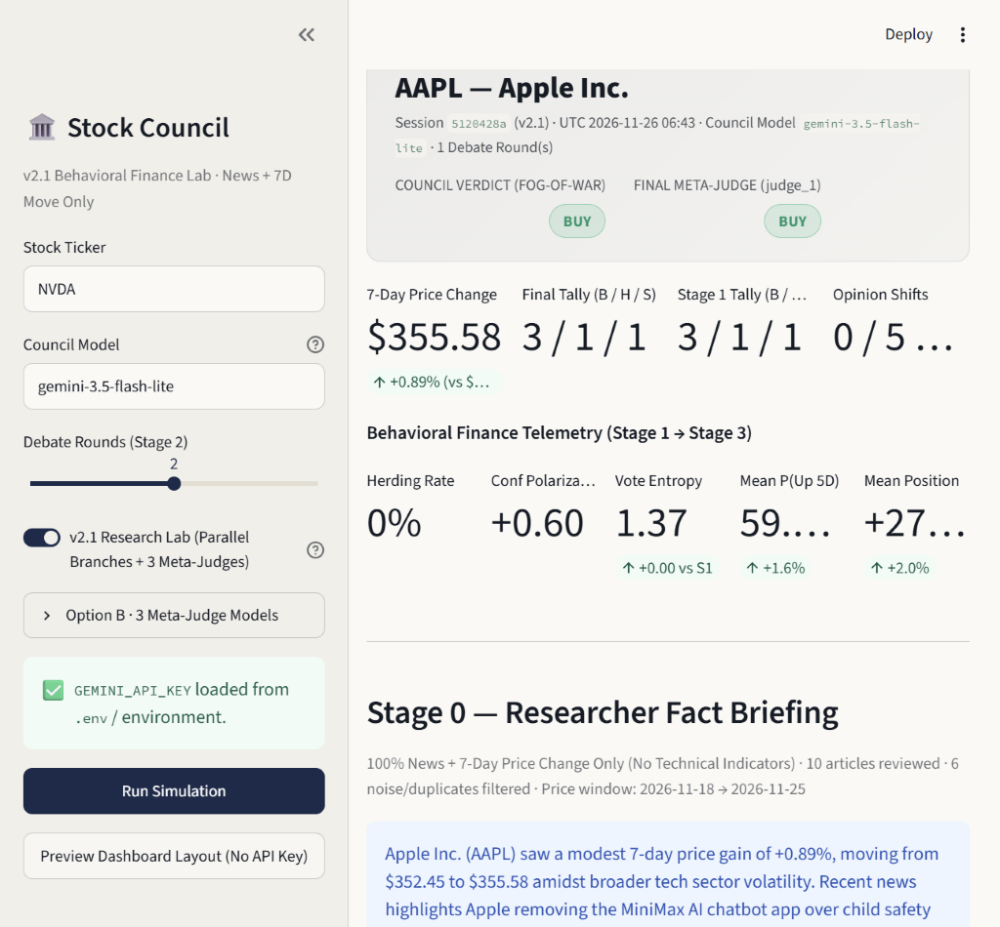

# AI-stock-council-sim (Stock Council Simulator · v2.1 Behavioral Finance Lab)

**Language:** **English** | [ภาษาไทย](README.th.md)

A standalone **Multi-Agent Behavioral Finance Simulator & Research Lab** that analyzes equities using **100% recent news + 7-day price change percentage ONLY** — strictly **zero technical indicators** (no RSI, MACD, moving averages, or chart patterns).

Built with Python 3.15, the official `google-genai` SDK (async Pydantic Structured Outputs) + multi-provider adapters (OpenAI, Anthropic Claude, Local Ollama), `yfinance`, `asyncio`, Streamlit, and `pytest`.

---

## Key Capabilities

- **4-Stage Information-Asymmetry Pipeline (Fog of War vs. God View):**
  - **Stage 0 (Researcher):** Curates raw `yfinance` news + deterministic 7-day price change % into a clean `FactBriefing` (filters clickbait, duplicates, and off-topic noise).
  - **Stage 1 (Blind Probabilistic Vote):** 5 investor personas vote concurrently via `asyncio.gather()` emitting `vote`, `confidence`, `prob_up_5d` (0–100%), and `position_pct` (-100 to +100).
  - **Stage 2 (Fog-of-War Sequential Debate):** Enforces a strict **Anonymization Firewall** — agents see ONLY `FactBriefing` + anonymized Stage 1 tally + their **own** Stage 1 numeric prior (anti-amnesia) + prior debate turns. Other agents' Stage 1 identities and reasoning are structurally blocked.
  - **Stage 3 (Simultaneous Secret Final Vote & Telemetry):** Concurrent secret final ballots + automated behavioral telemetry (**Opinion Shift Rate**, **Herding Rate**, **Confidence Polarization**, **Vote Entropy**).
- **Stage 4 · Parallel Counterfactual Experiment Lab (Ablation Study):**
  - Runs 4 controlled branches on the exact same `FactBriefing`: **Branch A (`Single-Agent Baseline`)**, **Branch B (`Isolated Crowd`)**, **Branch C (`Fog-of-War Council`)**, and **Branch D (`Full-Herd Social Pressure`)**.
- **Stage 5 · 3 Blank Meta-Judges (Option B: Cross-Model Peer Selection):**
  - 3 character-free neutral evaluators on distinct models (`gemini-3.6-flash`, `gemini-3.5-flash`, `gemini-3.1-flash-lite`) perform **Parallel Shadow Scoring** (all 3 scored equally to eliminate selection bias) → **Anti-Self-Vote Peer Selection** (with deterministic Brier Score tie-breaking) → **Final Judge Synthesis**.
- **Multi-Provider AI Tier Slider & 429/503 Resilience:**
  - Supports **Google Gemini**, **OpenAI**, **Anthropic Claude**, and **Local Ollama** (`qwen3.5:4b`, `qwen2.5:7b`) from the sidebar.
  - Built-in Gemini Free-Tier `429` `retryDelay` parsing and automatic Gemini Flash failover on transient `503`/`429` spikes (kept isolated from Option B Meta-Judges for fair cross-model benchmarking).
- **Quick Pick & Hot 7D Behavioral Radar:**
  - Curated 4-group universe (`AI & Semiconductors`, `Mega-Cap Tech`, `Value, Finance & Crypto`, `Indices & Safe-Haven`) + live **Hot 7D Movers** scanner ranking strictly by `|7D Move %|` (zero technical indicators) with 1-click ticker loading.
- **Forward-Run Paper Evaluator (`T+1D / T+5D / T+10D` vs `SPY`):**
  - Zero look-ahead bias evaluation updating realized forward returns, directional Hit Rate, 5D Brier Score, and idempotent `data/judge_scoreboard.json`.
- **Path A & Path B Research / Training Pipelines:**
  - **Path A (`scripts/batch_run.py`):** Idempotent daily forward collector with RPM pacing and automatic forward return evaluation.
  - **Path B (`src/historical_dataset.py`, `scripts/train_calibrator.py`):** Point-in-time masked SEC 8-K Exhibit 99.1 historical evaluation runner, time-ordered L2 Logistic Calibrator (OOS Brier benchmark), and Unsloth ChatML SFT/DPO dataset exporter.

---

## Dashboard Visual Proof (Live `AAPL` v2.1 Run)

### God View Overview — Verdict Banner, Behavioral Telemetry & Stage 0 Fact Briefing


### Stage 4 Parallel Counterfactual Lab & Stage 5 Cross-Model Meta-Judges


---

## Architecture & Information Asymmetry


### Council Roster (6 Agents)
1. **Researcher Agent (Non-Voting Curator):** Deduplicates and filters clickbait/rumors/off-topic headlines into an authoritative `FactBriefing` anchored to deterministic 7-day price math.
2. **The Retail FOMO:** Chases viral narratives, hype, and short-term 7-day momentum; quick to panic-sell negative headlines.
3. **The Fundamentalist:** Ignores short-term noise; evaluates revenue, margins, business moat, and durable earning power.
4. **The Paranoid Bear:** Skeptical risk manager hunting for hidden downsides, regulatory/legal threats, competition, and priced-in traps.
5. **The Contrarian:** Challenges consensus and Stage 1 vote skew; hunts for emotional overreactions.
6. **The Macro Analyst:** Connects company headlines to industry cycles, supply chains, competitors, and macroeconomic conditions.

---

## Project Structure

```text
AI-stock-council-sim/
├── .env.example                    # GEMINI_API_KEY, DEFAULT_MODEL, META_JUDGE_MODELS, DEBATE_ROUNDS
├── .streamlit/config.toml          # Editorial light theme palette
├── requirements.txt                # Verified package versions (Python 3.15)
├── config.py                       # Safe env loader & immutable Settings snapshot
├── app.py                          # Streamlit Editorial Dashboard (Live Runner, Radar, Lab, Scoreboard, Replay)
├── run_dashboard.bat               # One-click Windows launcher
├── README.md                       # English documentation
├── README.th.md                    # Thai documentation (ภาษาไทย)
├── PROJECT_MEMORY.md               # Phase-gated roadmap, guardrails & current state
├── CHANGELOG.md                    # Engineering changelog & decision record
├── data/
│   └── history/                    # Saved SessionRecord JSON replays (gitignored)
├── docs/
│   └── screenshots/                # Live Streamlit v2.1 God View & Lab screenshots
├── scripts/
│   ├── batch_run.py                # Path A: Idempotent daily forward auto-collector
│   └── train_calibrator.py         # Path B: Masked eval runner, L2 Calibrator & Unsloth SFT/DPO exporter
├── src/
│   ├── __init__.py
│   ├── schemas.py                  # Pydantic v2 contracts (FactBriefing, AgentVote, BranchResult, MetaJudgePanelResult, SessionRecord)
│   ├── llm_client.py               # Multi-provider async structured output clients (Gemini, OpenAI, Anthropic, Ollama) + 429/503 failover
│   ├── data_fetcher.py             # yfinance news + 7-day price change % fetcher (zero indicators)
│   ├── stock_radar.py              # Quick Pick curated groups & Hot 7D Behavioral Movers scanner
│   ├── prompts.py                  # System prompts & structurally firewalled stage prompt builders
│   ├── orchestrator.py             # 4-stage pipeline + Parallel Counterfactual Lab + 3-Model Meta-Judges
│   ├── evaluator.py                # Zero look-ahead Forward-Run Evaluator (T+1D/5D/10D vs SPY) & Judge Scoreboard
│   ├── historical_dataset.py       # Point-in-time masked SEC 8-K Exhibit 99.1 historical dataset builder
│   ├── avatars.py                  # Editorial persona visual badges
│   ├── preview.py                  # In-memory UI Layout Preview builder (no API key required)
│   └── storage.py                  # Atomic JSON save, listing, and replay loading
└── tests/
    ├── test_orchestrator.py        # 10 tests: firewall, concurrency, v2.1 Lab, Meta-Judges, evaluator cache, AppTest
    └── test_training_pipeline.py   # 3 tests: text masking, point-in-time alignment, calibrator & Unsloth export
```

---

## Quick Start

### 1. Install Dependencies
```powershell
python -m pip install -r requirements.txt
```

### 2. Configure `.env`
```powershell
Copy-Item .env.example .env
```

Edit `.env`:
```dotenv
GEMINI_API_KEY=your_gemini_api_key_here
DEFAULT_MODEL=gemini-3.5-flash-lite
META_JUDGE_MODELS=gemini-3.6-flash,gemini-3.5-flash,gemini-3.1-flash-lite
DEBATE_ROUNDS=2
```

> You can also paste a temporary session-only API key directly in the sidebar, switch to Local Ollama (`qwen3.5:4b`), or click **Preview Layout** to inspect the entire v2.1 UI without an API key.

### 3. Launch the Dashboard
Double-click `run_dashboard.bat` on Windows, or run:
```powershell
python -m streamlit run app.py
```

### 4. Run Automated Tests (13 Tests, No API Key Required)
```powershell
python -m pytest -v
```

---

## Model Swapping & Multi-Provider Setup

1. **Persistent defaults (`.env`):** Set `DEFAULT_PROVIDER` (`gemini`, `openai`, `anthropic`, `ollama`), `DEFAULT_MODEL`, and `META_JUDGE_MODELS` (3 comma-separated models for Option B).
2. **Live UI override:** Use the **AI Model Tier Slider** (or check **Custom Model ID**) and expand **Meta-Judge Models** in the sidebar before clicking **Run Simulation**.

---

## Path A & Path B Research Pipelines (CLI)

### Path A — Idempotent Daily Forward Auto-Collector
```powershell
python scripts/batch_run.py --dry-run
python scripts/batch_run.py --tickers NVDA,AAPL,MSFT,AMD,TSLA --rounds 1 --lab
```

### Path B — Masked Historical Evaluation, Statistical Calibrator & Unsloth Export
```powershell
# 1. Run resumable masked historical eval (zero look-ahead)
python scripts/train_calibrator.py --run-eval --limit 30 --rounds 1

# 2. Fit time-ordered L2 Logistic Calibrator & report OOS Brier Score
python scripts/train_calibrator.py --calibrate

# 3. Export ChatML SFT + DPO datasets for Unsloth (Qwen 4B/7B)
python scripts/train_calibrator.py --export-unsloth
```
