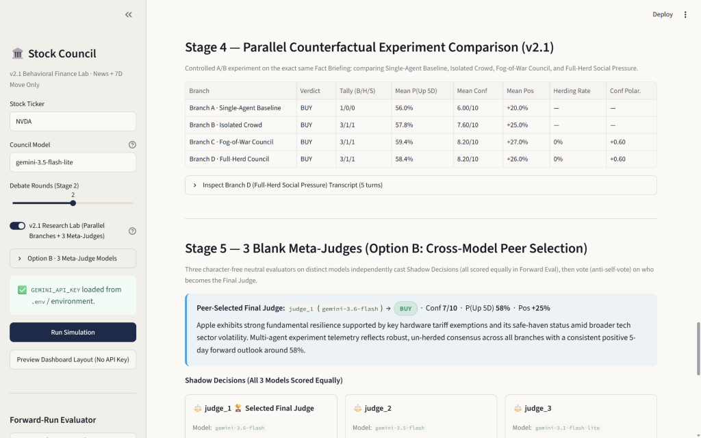
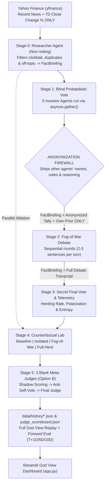

# Stock Council Simulator (v2.1 Behavioral Finance Lab)

A Multi-Agent Behavioral Finance Simulator & Research Lab that analyzes equities using **100% recent news + 7-day price change percentage ONLY** — strictly **zero technical indicators** (no RSI, MACD, moving averages, or chart patterns).

Built with Python 3.15, the official `google-genai` SDK (async Pydantic Structured Outputs), `yfinance`, `asyncio`, Streamlit, and `pytest`.

### What's Included in v2.1.1
- **4-Stage Information-Asymmetry Pipeline:** Stage 0 Researcher Briefing → Stage 1 Blind Probabilistic Vote (`prob_up_5d`, `position_pct`) → Stage 2 Sequential Fog-of-War Debate (anonymized tally + own numeric prior only) → Stage 3 Secret Final Vote & Behavioral Telemetry (`herding_rate`, `confidence_polarization`, `entropy`).
- **Stage 4 Parallel Counterfactual Lab (Ablation Study):** Runs 4 controlled branches on the exact same `FactBriefing` (`Single-Agent Baseline`, `Isolated Crowd`, `Fog-of-War Council`, `Full-Herd Social Pressure`).
- **Stage 5 Cross-Model Meta-Judges (Option B):** 3 character-free neutral evaluators on distinct models (`gemini-3.6-flash`, `gemini-3.5-flash`, `gemini-3.1-flash-lite`) with Parallel Shadow Scoring, Anti-Self-Vote Peer Selection, and Brier Score tie-breaking.
- **Forward-Run Paper Evaluator (`T+1D / T+5D / T+10D` vs `SPY`):** Zero look-ahead bias evaluation with idempotent `data/judge_scoreboard.json` tracking and single-pass `yfinance` caching.

---

## Dashboard Visual Proof (Live `AAPL` v2.1 Run)

### God View Overview — Verdict Banner, Behavioral Telemetry & Stage 0 Fact Briefing


### Stage 4 Parallel Counterfactual Lab & Stage 5 Cross-Model Meta-Judges


---

## Architecture & Information Asymmetry (Fog of War vs. God View)



### Council Roster (6 Agents)
1. **Researcher Agent (Non-Voting Curator):** Deduplicates and filters clickbait/rumors/off-topic headlines into an authoritative `FactBriefing` anchored to deterministic 7-day price math.
2. **The Retail FOMO:** Chases viral narratives, hype, and short-term 7-day momentum; quick to panic-sell negative headlines.
3. **The Fundamentalist:** Ignores short-term noise; evaluates revenue, margins, business moat, and durable earning power.
4. **The Paranoid Bear:** Skeptical risk manager hunting for hidden downsides, regulatory/legal threats, competition, and priced-in traps.
5. **The Contrarian:** Challenges consensus and Stage 1 vote skew; hunts for emotional overreactions.
6. **The Macro Analyst:** Connects company headlines to industry cycles, supply chains, competitors, and macroeconomic conditions.

---

## Project Structure

```text
AI-stock-council-sim/
├── .env.example              # GEMINI_API_KEY, DEFAULT_MODEL=gemini-3.5-flash-lite, META_JUDGE_MODELS, DEBATE_ROUNDS=2
├── requirements.txt          # Pinned to exact verified versions on this workstation
├── config.py                 # Safe env loader (_parse_int/_parse_float) and immutable runtime settings
├── app.py                    # Streamlit UI (Live Runner + History Replay + God View + Forward Evaluator)
├── run_dashboard.bat         # One-click Windows launcher for Streamlit
├── PROJECT_MEMORY.md         # Local project roadmap, guardrails, and current state
├── CHANGELOG.md              # Engineering changelog & decision record
├── data/
│   └── history/              # Auto-created directory storing SessionRecord JSON replays (gitignored)
├── docs/
│   └── screenshots/          # Real Streamlit v2.1 God View & Counterfactual Lab screenshots
├── src/
│   ├── __init__.py
│   ├── schemas.py            # Pydantic v2 contracts (FactBriefing, AgentVote, BranchResult, MetaJudgePanelResult, SessionRecord)
│   ├── llm_client.py         # Async structured output clients (Gemini google-genai + multi-provider) with retries
│   ├── data_fetcher.py       # yfinance news + 7-day price change % fetcher (zero indicators)
│   ├── prompts.py            # System prompts + structurally firewalled stage prompt builders
│   ├── orchestrator.py       # 4-stage pipeline + Parallel Counterfactual Lab + 3-Model Meta-Judges
│   ├── evaluator.py          # Zero look-ahead Forward-Run Evaluator (T+1D/5D/10D vs SPY) & Judge Scoreboard
│   ├── preview.py            # In-memory UI Layout Preview builder (no API key required)
│   └── storage.py            # Atomic JSON save, listing, and replay loading
└── tests/
    └── test_orchestrator.py  # 10 unit tests (firewall, concurrency, v2.1 Lab, Meta-Judges, evaluator cache, AppTest)
```

---

## Quick Start

### 1. Install Dependencies
Dependencies are pinned in `requirements.txt` to match the verified Python 3.15 environment:

```powershell
python -m pip install -r requirements.txt
```

### 2. Configure Your Gemini API Key
Copy `.env.example` to `.env` and insert your Gemini API key:

```powershell
Copy-Item .env.example .env
```

Edit `.env`:

```dotenv
GEMINI_API_KEY=your_gemini_api_key_here
DEFAULT_MODEL=gemini-3.5-flash-lite
META_JUDGE_MODELS=gemini-3.6-flash,gemini-3.5-flash,gemini-3.1-flash-lite
DEBATE_ROUNDS=2
```

> You can also paste a temporary session-only API key directly in the Streamlit sidebar without saving it to disk, or click **Preview Dashboard Layout (No API Key)** to inspect the entire v2.1 UI immediately.

### 3. Run the Streamlit App
Use `python -m streamlit` so it runs cleanly even if Python's `Scripts/` folder is not on your Windows `PATH`:

```powershell
python -m streamlit run app.py
```

### 4. Run Automated Tests (No API Key Required)
All 10 unit tests mock LLM calls deterministically:

```powershell
python -m pytest -v
```

---

## How to Swap Models

You can switch Gemini models in two ways without touching any code:

1. **Persistent default (`.env`):** Change `DEFAULT_MODEL` (e.g., `gemini-3.5-flash-lite`, `gemini-3.5-flash`, `gemini-3.6-flash`) or `META_JUDGE_MODELS` (3 comma-separated models for Option B) in `.env` and restart Streamlit.
2. **Per-run override (UI):** Edit **Council Model** or expand **Option B · 3 Meta-Judge Models** in the Streamlit sidebar before clicking **Run Simulation**. The exact model names used are stored inside each `data/history/*.json` record for reproducible replay.
