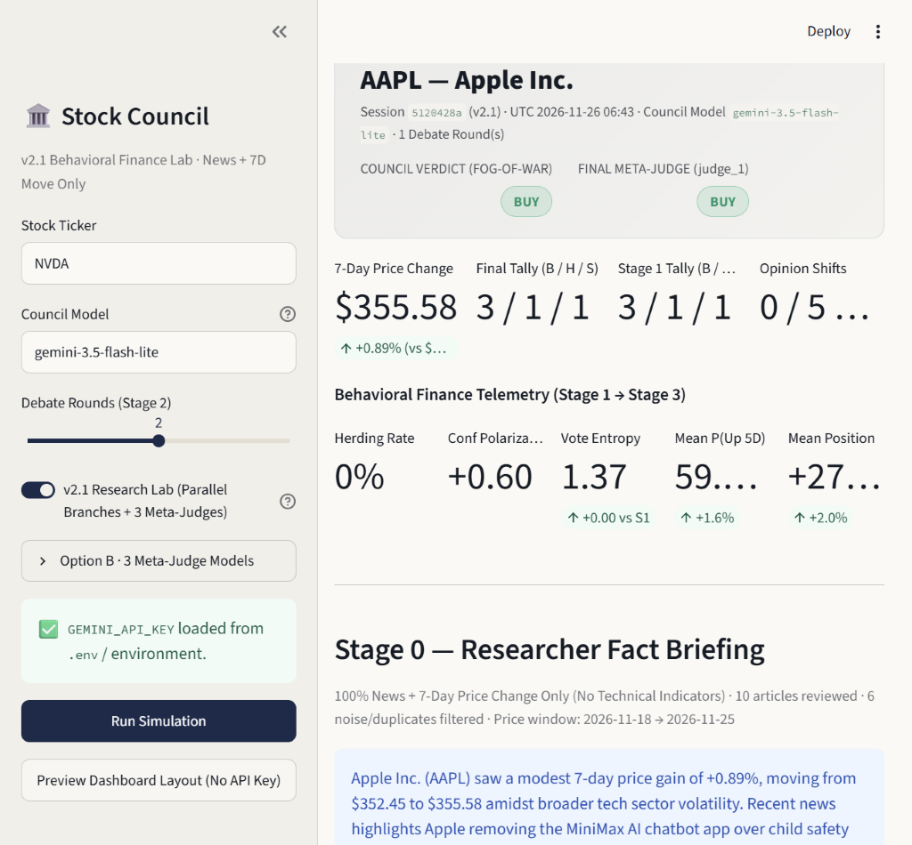
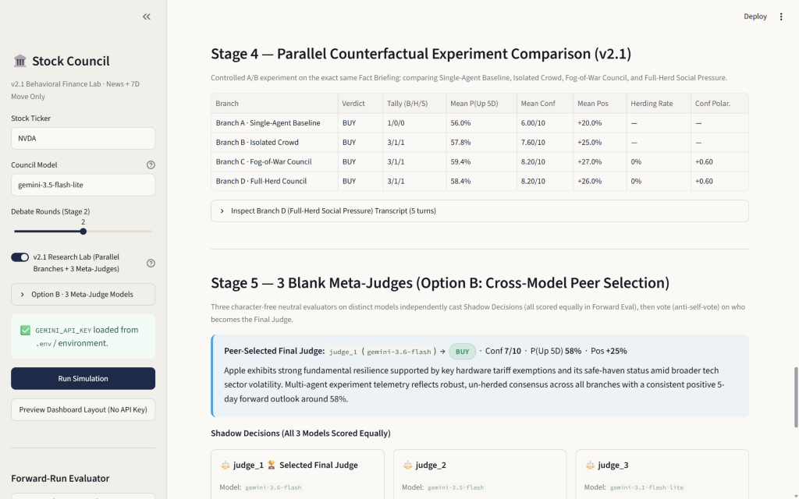
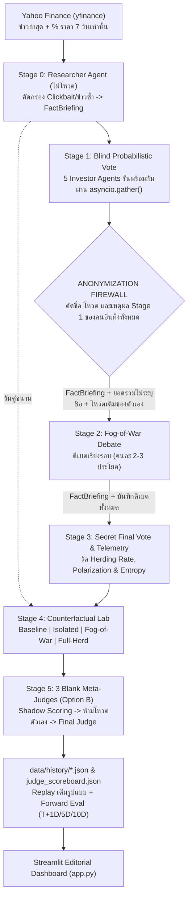

# AI-stock-council-sim (Stock Council Simulator · v2.1 Behavioral Finance Lab)

**ภาษา:** [English](README.md) | **ภาษาไทย**

ระบบจำลองสภานักลงทุนและห้องแล็บวิจัยด้าน **Behavioral Finance** แบบ Multi-Agent ที่วิเคราะห์หุ้นด้วย **ข่าวล่าสุด 100% + เปอร์เซ็นต์การเปลี่ยนแปลงราคา 7 วันเท่านั้น** — **ไม่ใช้ Technical Indicators ใดๆ ทั้งสิ้น** (ไม่มี RSI, MACD, Moving Averages หรือ Chart Patterns)

พัฒนาด้วย Python 3.15, Official `google-genai` SDK (Async Pydantic Structured Outputs) พร้อมรองรับหลายผู้ให้บริการ (OpenAI, Anthropic Claude, Local Ollama), `yfinance`, `asyncio`, Streamlit และ `pytest`

---

## ความสามารถหลักของระบบ

- **Pipeline 4 ขั้นตอนแบบแยกชั้นข้อมูล (Fog of War vs. God View):**
  - **Stage 0 (Researcher Agent — ไม่โหวต):** ดึงข่าวล่าสุด + % เปลี่ยนแปลงราคา 7 วันจาก `yfinance` คัดกรองข่าว Clickbait, ข่าวซ้ำ และข่าวนอกเรื่อง ออกเป็น `FactBriefing` โดยล็อกตัวเลขราคาฝั่งโค้ดแบบ Deterministic กัน LLM หลอนตัวเลข
  - **Stage 1 (Blind Probabilistic Vote):** นักลงทุนทั้ง 5 คาแรคเตอร์โหวตพร้อมกันผ่าน `asyncio.gather()` โดยออกค่า `vote`, `confidence (1–10)`, `prob_up_5d (0–100%)` และ `position_pct (-100 ถึง +100)`
  - **Stage 2 (Fog-of-War Debate):** บังคับใช้ **Anonymization Firewall เชิงโครงสร้าง** — Agent แต่ละตัวเห็นเฉพาะ `FactBriefing` + ยอดโหวตรวมแบบไม่ระบุชื่อ (`BUY: X | HOLD: Y | SELL: Z`) + ค่าโหวตเดิมของ **ตัวเองเท่านั้น** (แก้ Self-Amnesia) + บทสนทนาก่อนหน้า ห้ามเห็นชื่อหรือเหตุผล Stage 1 ของคนอื่นเด็ดขาด
  - **Stage 3 (Secret Final Vote & Behavioral Telemetry):** โหวตลับรอบสุดท้ายพร้อมกันผ่าน `asyncio.gather()` พร้อมคำนวณตัวชี้วัดเชิงพฤติกรรมอัตโนมัติ (**Opinion Shift Rate**, **Herding Rate**, **Confidence Polarization**, **Vote Entropy**)
- **Stage 4 · Parallel Counterfactual Lab (การทดลองเปรียบเทียบคู่ขนาน):**
  - รัน 4 สาขาควบคุมพร้อมกันบน `FactBriefing` เดียวกันเป๊ะ: **Branch A (`Single-Agent Baseline`)**, **Branch B (`Isolated Crowd`)**, **Branch C (`Fog-of-War Council`)** และ **Branch D (`Full-Herd Social Pressure`)** เพื่อวัดผลกระทบของแรงกดดันทางสังคม
- **Stage 5 · 3 Blank Meta-Judges (Option B: กรรมการไร้อารมณ์ 3 โมเดล):**
  - ใช้ AI ที่เป็นกลางไร้คาแรคเตอร์ 3 ตัวบน 3 โมเดลแยกกัน (`gemini-3.6-flash`, `gemini-3.5-flash`, `gemini-3.1-flash-lite`) ทำ **Parallel Shadow Scoring** (เก็บคะแนนจริงเท่ากันทั้ง 3 ตัวเพื่อกัน Selection Bias) → **Peer Selection แบบห้ามโหวตตัวเอง** (พร้อมตัวชี้ขาดด้วย Brier Score) → ให้ตัวที่ชนะออก **Final Meta Verdict**
- **Multi-Provider AI Tier Slider & ระบบกันล่ม 429/503:**
  - สลับใช้งาน **Google Gemini**, **OpenAI**, **Anthropic Claude**, และ **Local Ollama** (`qwen3.5:4b`, `qwen2.5:7b`) ได้จาก Sidebar
  - อ่านเวลา `retryDelay` ของ Gemini Free Tier `429` (15 RPM) อัตโนมัติ พร้อมระบบ **Automatic Gemini Flash Failover** เมื่อเจอ `503 High Demand` (แยกไม่ให้ปนกับ 3 Meta-Judges เพื่อความยุติธรรมในการวัดผลข้ามโมเดล)
- **Quick Pick & Hot 7D Behavioral Radar:**
  - รวมชุดหุ้นคัดสรร 4 กลุ่ม (`AI & Semiconductors`, `Mega-Cap Tech`, `Value, Finance & Crypto`, `Indices & Safe-Haven`) และเรดาร์สแกนหุ้นเหวี่ยงแรงสุดใน 7 วัน (`|7D Move %|` เท่านั้น ไม่มีอินดิเคเตอร์) คลิกโหลดเข้า Council ได้ใน 1 คลิก
- **Forward-Run Paper Evaluator (`T+1D / T+5D / T+10D` เทียบ `SPY`):**
  - วัดผลตอบแทนจริงหลังวันรันแบบ **Zero Look-ahead Bias** คำนวณ Directional Hit Rate, 5D Brier Score และอัปเดต `data/judge_scoreboard.json` แบบ Idempotent
- **Path A & Path B Research / Training Pipelines:**
  - **Path A (`scripts/batch_run.py`):** สคริปต์เก็บข้อมูล Forward Run รายวันอัตโนมัติแบบ Idempotent
  - **Path B (`src/historical_dataset.py`, `scripts/train_calibrator.py`):** ระบบดึงข่าว SEC 8-K Exhibit 99.1 แบบปิดบังชื่อ/วันที่ (Masked Point-in-Time), เทรน L2 Logistic Calibrator วัด OOS Brier Score และส่งออกชุดข้อมูล ChatML SFT/DPO สำหรับ **Unsloth**

---

## ตัวอย่างหน้าจอจริง (Live `AAPL` v2.1 Run)

### God View Overview — Verdict Banner, Behavioral Telemetry และ Stage 0 Fact Briefing


### Stage 4 Parallel Counterfactual Lab และ Stage 5 Cross-Model Meta-Judges


---

## สถาปัตยกรรมและกฎ Information Asymmetry



### สมาชิกในสภา (6 Agents)
1. **Researcher Agent (ผู้คัดกรอง — ไม่โหวต):** คัดกรองข่าวซ้ำ ข่าวลือ และ Clickbait ออกเป็น `FactBriefing` ที่ยึดตัวเลขราคา 7 วันจริง
2. **The Retail FOMO:** สายไล่กระแสและโมเมนตัมระยะสั้น ตื่นเต้นไวกับข่าวบวกและแพนิกขายไวเมื่อเจอพาดหัวร้าย
3. **The Fundamentalist:** เมินเสียงรบกวนรายวัน โฟกัสที่รายได้ อัตรากำไร ความแข็งแกร่งของธุรกิจ (Moat) และกระแสเงินสดระยะยาว
4. **The Paranoid Bear:** สายคุมความเสี่ยงขี้ระแวง มองหาหลุมพราง คดีความ กฎระเบียบ คู่แข่ง และกับดักราคาที่รับรู้ข่าวดีไปแล้ว
5. **The Contrarian:** สายสวนกระแส ท้าทายเสียงข้างมากและจับอาการ Overreaction ของตลาด
6. **The Macro Analyst:** เชื่อมข่าวรายบริษัทเข้ากับวัฏจักรอุตสาหกรรม ห่วงโซ่อุปทาน คู่แข่ง และเศรษฐกิจมหภาค

---

## โครงสร้างโปรเจกต์

```text
AI-stock-council-sim/
├── .env.example                    # ตัวอย่างค่า API Key, DEFAULT_MODEL, META_JUDGE_MODELS, DEBATE_ROUNDS
├── .streamlit/config.toml          # ธีมสี Editorial Light Mode
├── requirements.txt                # แพ็กเกจที่พินเวอร์ชันไว้ (Python 3.15)
├── config.py                       # ตัวโหลด Environment Variables และ Settings
├── app.py                          # หน้า Dashboard หลัก (Live Runner, Radar, Lab, Scoreboard, Replay)
├── run_dashboard.bat               # ปุ่มดับเบิลคลิกรัน Dashboard บน Windows
├── README.md                       # คู่มือภาษาอังกฤษ
├── README.th.md                    # คู่มือภาษาไทย (ไฟล์นี้)
├── PROJECT_MEMORY.md               # แผนงาน Phase-Gated และสถานะล่าสุดของโปรเจกต์
├── CHANGELOG.md                    # บันทึกการเปลี่ยนแปลงและการตัดสินใจเชิงวิศวกรรม
├── data/
│   └── history/                    # โฟลเดอร์เก็บไฟล์ JSON ย้อนหลังสำหรับ Replay (ถูก gitignore)
├── docs/
│   └── screenshots/                # ภาพหน้าจอจริงของ Dashboard v2.1
├── scripts/
│   ├── batch_run.py                # Path A: สคริปต์เก็บข้อมูล Forward Run รายวันอัตโนมัติ
│   └── train_calibrator.py         # Path B: สคริปต์รัน Masked Eval, เทรน Calibrator และส่งออก Unsloth
├── src/
│   ├── __init__.py
│   ├── schemas.py                  # Pydantic v2 Models ทั้งระบบ
│   ├── llm_client.py               # Client หลายค่าย (Gemini, OpenAI, Anthropic, Ollama) + ระบบกัน 429/503
│   ├── data_fetcher.py             # ตัวดึงข่าว + % ราคา 7 วันจาก yfinance (ไม่มีอินดิเคเตอร์)
│   ├── stock_radar.py              # Quick Pick 4 กลุ่มหุ้น + เรดาร์สแกนหุ้นเหวี่ยงแรง 7 วัน
│   ├── prompts.py                  # System Prompts และ Prompt Builders ที่มี Firewall
│   ├── orchestrator.py             # ตัวคุม 4-Stage Pipeline + Parallel Lab + 3 Meta-Judges
│   ├── evaluator.py                # ตัววัดผล Forward Return (T+1D/5D/10D vs SPY) และ Judge Scoreboard
│   ├── historical_dataset.py       # ตัวดึงและปิดบังข้อมูล SEC 8-K Exhibit 99.1 ย้อนหลัง
│   ├── avatars.py                  # ป้ายสัญลักษณ์ประจำตัวของแต่ละ Persona
│   ├── preview.py                  # โหมดจำลองหน้าตา UI เปล่า (ไม่ต้องใช้ API Key)
│   └── storage.py                  # ระบบบันทึก โหลด และเรียงประวัติ Session JSON แบบ Atomic
└── tests/
    ├── test_orchestrator.py        # 10 ยูนิตเทสต์ (Firewall, Concurrency, Lab, Meta-Judges, AppTest)
    └── test_training_pipeline.py   # 3 ยูนิตเทสต์ (Text Masking, Point-in-Time, Calibrator & Unsloth)
```

---

## วิธีติดตั้งและเริ่มต้นใช้งาน

### 1. ติดตั้ง Dependencies
```powershell
python -m pip install -r requirements.txt
```

### 2. ตั้งค่าไฟล์ `.env`
```powershell
Copy-Item .env.example .env
```

แก้ไขไฟล์ `.env` แล้วใส่คีย์ของคุณ:
```dotenv
GEMINI_API_KEY=your_gemini_api_key_here
DEFAULT_MODEL=gemini-3.5-flash-lite
META_JUDGE_MODELS=gemini-3.6-flash,gemini-3.5-flash,gemini-3.1-flash-lite
DEBATE_ROUNDS=2
```

> สามารถกรอก API Key ชั่วคราวใน Sidebar ได้โดยไม่บันทึกลงดิสก์ หรือสลับไปใช้ Local Ollama (`qwen3.5:4b`) รวมถึงกดปุ่ม **Preview Layout** เพื่อดูหน้าตา Dashboard ครบทุกส่วนได้ทันทีโดยไม่ต้องใช้ API Key

### 3. เปิดหน้า Dashboard
ดับเบิลคลิกไฟล์ `run_dashboard.bat` หรือรันผ่าน Terminal:
```powershell
python -m streamlit run app.py
```

### 4. รันชุดทดสอบอัตโนมัติ (13 Tests — ไม่ต้องใช้ API Key)
```powershell
python -m pytest -v
```

---

## วิธีสลับโมเดลและผู้ให้บริการ AI

1. **ตั้งค่าถาวรใน `.env`:** ปรับ `DEFAULT_PROVIDER` (`gemini`, `openai`, `anthropic`, `ollama`), `DEFAULT_MODEL` และ `META_JUDGE_MODELS` (ระบุ 3 โมเดลคั่นด้วยจุลภาคสำหรับ Option B)
2. **สลับหน้างานใน UI:** เลื่อน **AI Model Tier Slider** (หรือติ๊ก **Custom Model ID**) และเปิดหัวข้อ **Meta-Judge Models** ใน Sidebar ก่อนกด **Run Simulation**

---

## การใช้งาน Research & Training Pipelines (CLI)

### Path A — เก็บข้อมูล Forward Run รายวันอัตโนมัติ
```powershell
python scripts/batch_run.py --dry-run
python scripts/batch_run.py --tickers NVDA,AAPL,MSFT,AMD,TSLA --rounds 1 --lab
```

### Path B — ประเมินข้อมูลย้อนหลังแบบปิดบังชื่อ (Masked Eval), เทรน Calibrator และส่งออก Unsloth
```powershell
# 1. รันประเมินชุดข้อมูล SEC 8-K ย้อนหลังแบบปิดบังชื่อ/วันที่ (ทำต่อจากจุดเดิมได้)
python scripts/train_calibrator.py --run-eval --limit 30 --rounds 1

# 2. เทรน L2 Logistic Calibrator แบบเรียงตามเวลาและแสดง OOS Brier Score
python scripts/train_calibrator.py --calibrate

# 3. ส่งออกไฟล์ ChatML SFT + DPO สำหรับเทรนต่อด้วย Unsloth (Qwen 4B/7B)
python scripts/train_calibrator.py --export-unsloth
```
